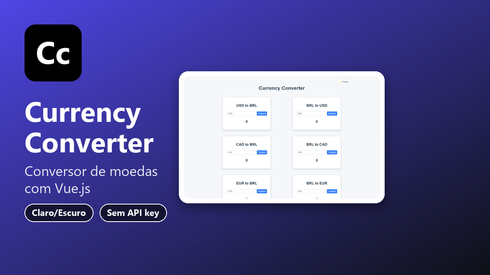
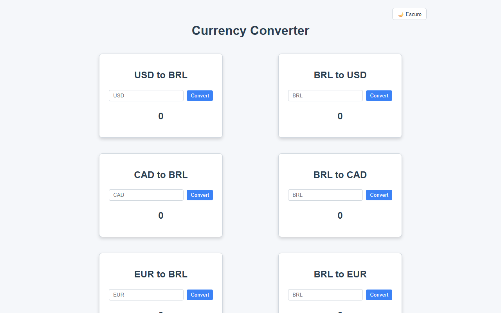
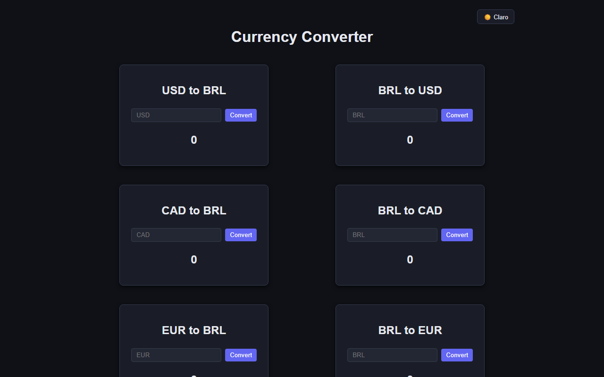

# Currency Converter

<p align="center">
  
</p>

Conversor de moedas feito com Vue.js. Converte USD, CAD e EUR para BRL e vice-versa, com tema claro e escuro (escuro por padrão).

**[Abrir a aplicação](https://gabrieldmonteiro.github.io/CurrencyConverter_VueJs/)**

## Telas

| Tema claro | Tema escuro |
|---|---|
|  |  |

## Download

A aplicação roda direto no navegador. Não há instalador. Use o link acima.

## Projeto

```
npm install
npm run serve   # desenvolvimento
npm run build   # produção (saída em dist/)
```

Cotações: [Frankfurter](https://www.frankfurter.app/) (dados do Banco Central Europeu). Serviço de terceiros, sem chave de API.

---

# Currency Converter (English)

Currency converter built with Vue.js. Converts USD, CAD and EUR to BRL and back, with light and dark themes (dark by default).

**[Open the app](https://gabrieldmonteiro.github.io/CurrencyConverter_VueJs/)**

| Light theme | Dark theme |
|---|---|
|  |  |

Rates come from [Frankfurter](https://www.frankfurter.app/) (European Central Bank data). Third-party service, no API key required.

| Asset | File |
|---|---|
| Social post (light) | [docs/images/social-post.png](docs/images/social-post.png) |
| Social post (dark) | [docs/images/social-post-dark.png](docs/images/social-post-dark.png) |
| Icon | [docs/images/icon.png](docs/images/icon.png) · [build/icon.ico](build/icon.ico) |
